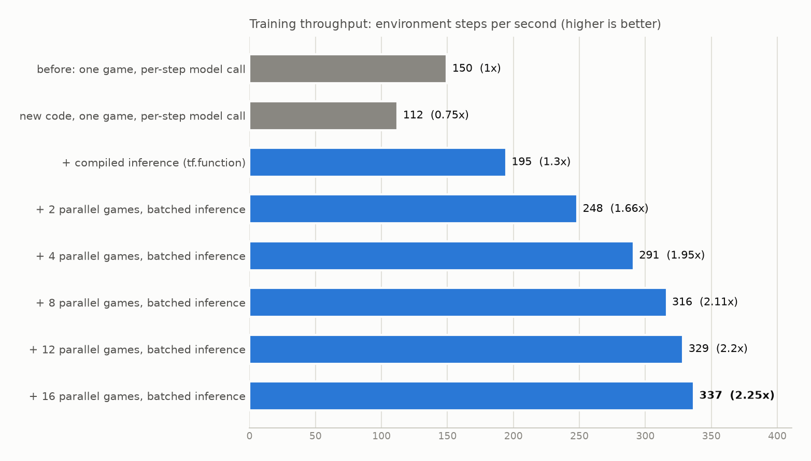

# deep-rl-breakout-game

Using Deep Q Networks (DQN) to play Atari Breakout, with TensorFlow/Keras and `gym` + `ale-py`.

The agent follows the setup from the DeepMind Nature paper: frame skipping with max-pooling, 84x84 grayscale
frames, a stack of the last 4 frames, an experience replay buffer, and a periodically synced target network.

This repository has two parts:

| File | What it is |
| --- | --- |
| [`train.py`](train.py) | Tested command-line training script. Use this to train. |
| [`deep_q_network.ipynb`](deep_q_network.ipynb) | Early exploratory notebook the script grew out of. |

## Train

Requires Python 3.11 (see `.python-version`): `gym==0.26.2` and `ale-py==0.8.1` have no wheels for newer versions.

```bash
python -m venv venv && source venv/bin/activate
pip install -r requirements.txt

python train.py --max-steps 120000                 # about 7 minutes on a 16-thread CPU
python train.py --model models/<saved>.keras       # resume from a checkpoint
python train.py --evaluate models/<saved>.keras    # average score of a saved model
```

Checkpoints are written to `models/` (or `--save-dir`) every 100,000 steps and at the end. They are git-ignored.

## What the script does

Standard DQN, with the settings that make Breakout learnable:

- frames are scaled to [0, 1] inside the network (`Rescaling`)
- epsilon decays linearly from 1.0 to 0.1 over the first 50,000 steps
- 5,000 warm-up steps before training, one update every 4 steps, replay buffer of 50,000 transitions
- rewards clipped to [-1, 1], Huber loss, target network synced every 1,000 steps
- FIRE is pressed at the start of the game and after every lost life; otherwise the ball is never launched

## Results

Trained for 120,000 steps (1,677 episodes) on CPU, then evaluated over 30 episodes (epsilon 0.05):

| Policy | Mean score | Best | Worst |
| --- | --- | --- | --- |
| Random | 1.57 | 3 | 0 |
| Trained DQN | 7.87 | 12 | 3 |

The training curve rose from about 2 to about 7 over the run and was still trending up when it stopped, so longer
runs should do better. The first version of this script (no input scaling, epsilon decaying to its floor within
a few hundred steps, no warm-up, no FIRE handling) did not learn: its score fell from about 2.4 to 0 in 58 episodes.

## Training speed

Measured on an AMD Ryzen 7 7435HS (8 cores / 16 threads), CPU only, TensorFlow 2.19, training updates active:

<picture>
  <source media="(prefers-color-scheme: dark)" srcset="docs/speedup_dark.png">
  
</picture>

Two changes account for the **2.1x speedup** (150 to 316 steps/s with 8 games; `python benchmark.py` reproduces the table):

1. **Compiled move selection.** Choosing a move used to cost 7.3 ms per frame, almost all of it Keras call overhead for a
   batch of one. Wrapping the network call in `tf.function` brings it to 0.4 ms.
2. **Parallel games.** `--num-envs N` runs N games in separate processes and sends their frames through the network
   as one batch. The exploration schedule, warm-up, update frequency and target sync are all counted in environment
   steps summed over the games, so they mean the same thing for any N.

Moving the game into its own process costs some time on its own (the 112 steps/s row), which compilation and
batching more than win back. Beyond about 8 games the gains flatten: the training update (about 9 ms per batch of 32,
mostly convolutions on the CPU) is now the bottleneck, and compiling it with XLA only saves 8%. A working GPU would
help there, but not for the per-step work above.

## Notebook status

The notebook is kept for reference and is not maintained. It is written against the same old `gym`/`ale-py`
versions, so its `!pip install "gym[atari, accept-rom-license]"` cell will not work on a Google Colab runtime
that defaults to Python 3.12. It also reads and writes models in a Google Drive folder
(`/content/drive/My Drive/dqn`); create it or edit the path in the second cell. To use it today, run it on
Python 3.11, or port it to `gymnasium` and a current `ale-py`.

## License

[MIT](LICENSE)
