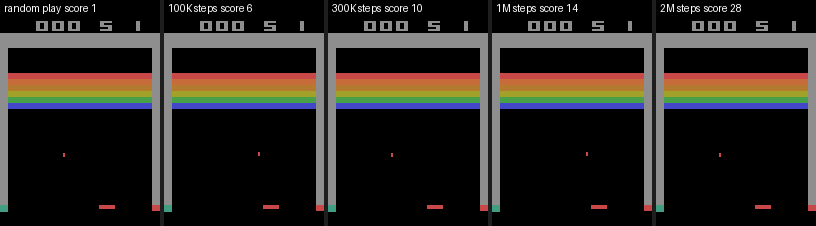
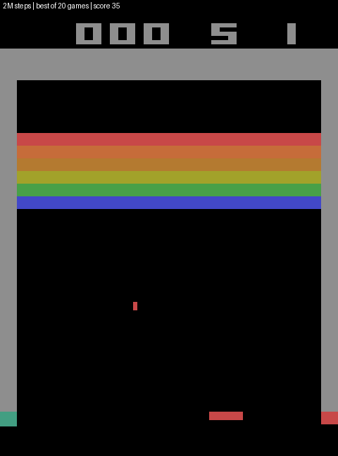
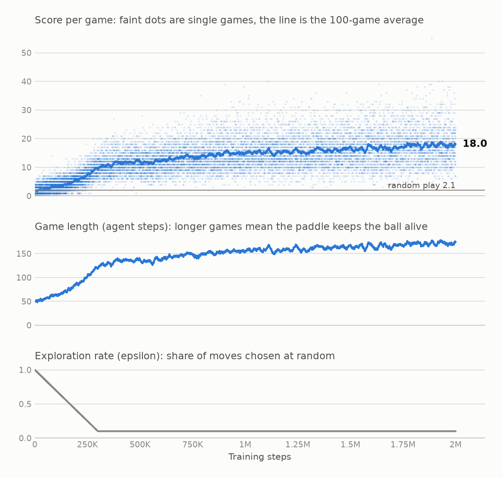
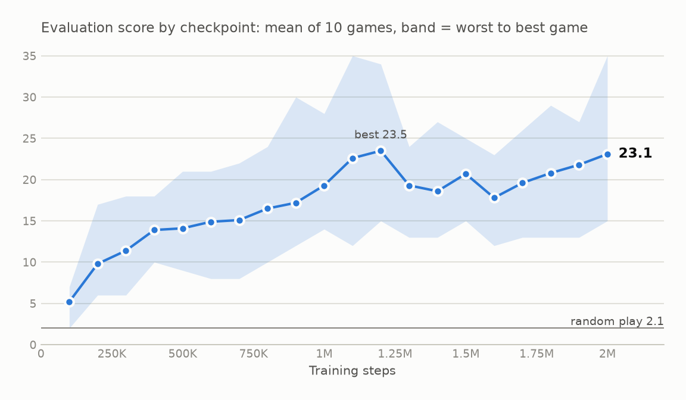

# deep-rl-breakout-game

Using Deep Q Networks (DQN) to play Atari Breakout, with TensorFlow/Keras and `gym` + `ale-py`.

The agent follows the setup from the DeepMind Nature paper: frame skipping with max-pooling, 84x84 grayscale
frames, a stack of the last 4 frames, an experience replay buffer, and a periodically synced target network.

This repository has two parts:

| File | What it is |
| --- | --- |
| [`train.py`](train.py) | Tested command-line training script. Use this to train. |
| [`deep_q_network.ipynb`](deep_q_network.ipynb) | Early exploratory notebook the script grew out of. |

## Train

Requires Python 3.11 (see `.python-version`): `gym==0.26.2` and `ale-py==0.8.1` have no wheels for newer versions.

```bash
python -m venv venv && source venv/bin/activate
pip install -r requirements.txt

python train.py --max-steps 120000                 # about 7 minutes on a 16-thread CPU
python train.py --model models/<saved>.keras       # resume from a checkpoint
python train.py --evaluate models/<saved>.keras    # average score of a saved model
```

Checkpoints are written to `models/` (or `--save-dir`) every 100,000 steps and at the end. They are git-ignored.

## What the script does

Standard DQN, with the settings that make Breakout learnable:

- frames are scaled to [0, 1] inside the network (`Rescaling`)
- epsilon decays linearly from 1.0 to 0.1 over the first 50,000 steps
- 5,000 warm-up steps before training, one update every 4 steps, replay buffer of 50,000 transitions
- rewards clipped to [-1, 1], Huber loss, target network synced every 1,000 steps
- FIRE is pressed at the start of the game and after every lost life; otherwise the ball is never launched

## Results

A 2-million-step run on a laptop CPU, in about 2 hours (see the speedups below). Each panel shows the median-scoring
game out of five played by that checkpoint, so none of them is cherry-picked:



| Policy | Mean score | Median | Best game |
| --- | --- | --- | --- |
| Random play (50 games) | 2.1 | 2 | 6 |
| Agent after 100K steps (10 games) | 5.2 | | 7.0 |
| Agent after 1M steps (10 games) | 19.3 | | 28.0 |
| **Agent after 2M steps (50 games)** | **25.3** | 26 | 44 |

Evaluations use epsilon 0.02. The final agent scores about 12 times random play. Here is its best game out of 20
(picked as the best, so it flatters the average):



### How it learned

<picture>
  <source media="(prefers-color-scheme: dark)" srcset="docs/training_curves_dark.png">
  
</picture>

<picture>
  <source media="(prefers-color-scheme: dark)" srcset="docs/evaluation_dark.png">
  
</picture>

- **Fast start, slow finish.** Most of the gain comes in the first 300K steps, while epsilon decays. After that the
  score creeps up. The training average (about 18) is below the evaluation scores because training still takes 10% random moves.
- **It plateaued.** Evaluation scores reached about 23 by 1.1 to 1.2M steps and then moved between 18 and 23. Ten games per
  checkpoint has a standard error of about 1.5, so those wobbles are mostly noise. More steps of this exact setup are
  unlikely to help much.
- **It has not learned the advanced tricks.** Games still end within 10 to 20 seconds. Top Atari DQN results
  (hundreds of points) come from digging a tunnel up the side and letting the ball bounce behind the bricks; this agent
  has not found that. Likely levers are a bigger network, Double DQN or dueling heads, a lower final epsilon, and 10x more steps.
- **Where the first version went wrong.** The original script (no input scaling, epsilon gone within a few hundred
  steps, no warm-up, no FIRE handling) did not learn at all: its score fell from about 2.4 to 0 in 58 episodes.

The numbers behind the charts are in [`results/`](results/) (`training_log.csv`, `eval_results.json`).

### Reproduce

```bash
python train.py --max-steps 2000000 --num-envs 8 --epsilon-steps 300000 --replay-capacity 150000 \
                --target-update 2000 --checkpoint-steps 100000 --save-dir models
python evaluate_checkpoints.py models results/eval_results.json     # score every checkpoint
python make_montage.py models docs/progression.gif --steps 0 100000 300000 1000000 2000000
python make_montage.py models docs/best_game.gif --steps 2000000 --best-of 20 --fps 30
python plot_progress.py --log training.log --eval results/eval_results.json --out docs
```

(`training.log` is the training output piped through `grep ^Episode`. The published run was stopped and resumed once at
100K steps, from the checkpoint, to switch on the speedups below; `plot_progress.py` accepts several logs for that.)

## Training speed

Measured on an AMD Ryzen 7 7435HS (8 cores / 16 threads), CPU only, TensorFlow 2.19, training updates active:

<picture>
  <source media="(prefers-color-scheme: dark)" srcset="docs/speedup_dark.png">
  
</picture>

Two changes account for the **2.1x speedup** (150 to 316 steps/s with 8 games; `python benchmark.py` reproduces the table):

1. **Compiled move selection.** Choosing a move used to cost 7.3 ms per frame, almost all of it Keras call overhead for a
   batch of one. Wrapping the network call in `tf.function` brings it to 0.4 ms.
2. **Parallel games.** `--num-envs N` runs N games in separate processes and sends their frames through the network
   as one batch. The exploration schedule, warm-up, update frequency and target sync are all counted in environment
   steps summed over the games, so they mean the same thing for any N.

Moving the game into its own process costs some time on its own (the 112 steps/s row), which compilation and
batching more than win back. Beyond about 8 games the gains flatten: the training update (about 9 ms per batch of 32,
mostly convolutions on the CPU) is now the bottleneck, and compiling it with XLA only saves 8%. A working GPU would
help there, but not for the per-step work above.

## Notebook status

The notebook is kept for reference and is not maintained. It is written against the same old `gym`/`ale-py`
versions, so its `!pip install "gym[atari, accept-rom-license]"` cell will not work on a Google Colab runtime
that defaults to Python 3.12. It also reads and writes models in a Google Drive folder
(`/content/drive/My Drive/dqn`); create it or edit the path in the second cell. To use it today, run it on
Python 3.11, or port it to `gymnasium` and a current `ale-py`.

## License

[MIT](LICENSE)
